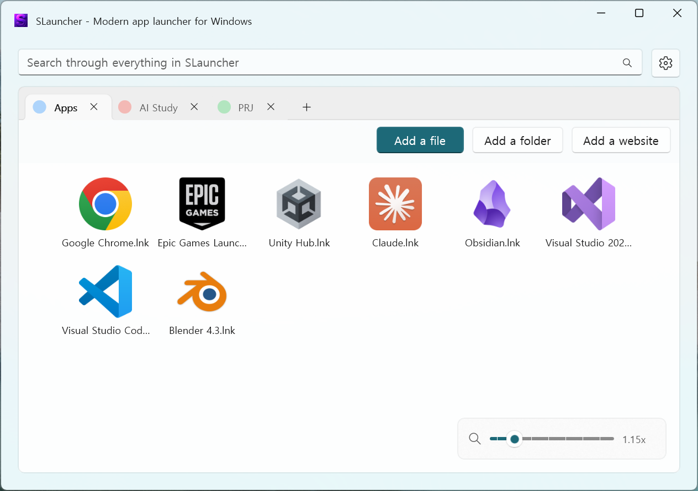
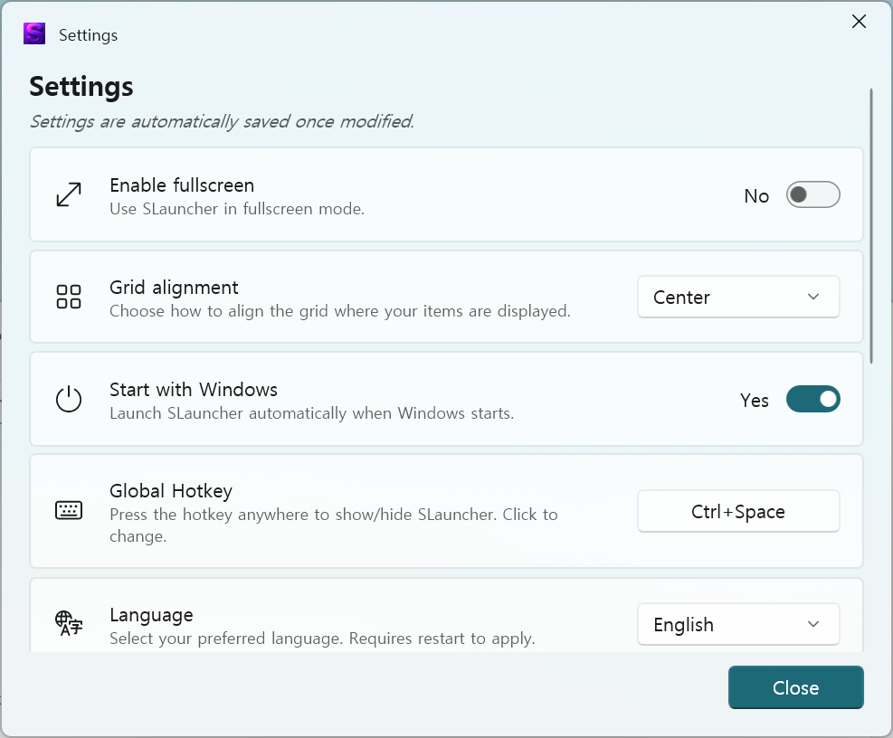

# SLauncher

<div align="center">


**一款适用于 Windows 的现代化多语言应用启动器**

[](LICENSE)
[](https://dotnet.microsoft.com/download)
[](https://microsoft.github.io/microsoft-ui-xaml/)

**语言：** [English](README.md) • [한국어](README.ko-KR.md) • [日本語](README.ja-JP.md) • [简体中文](README.zh-CN.md)

[功能](#features) • [安装](#installation) • [使用](#usage) • [从源代码构建](#building)

---

⭐ **如果你觉得这个项目有用，欢迎在 [GitHub](https://github.com/siriz/SLauncher) 上为它点星！**

</div>

---

> 简体中文支持情况请以具体发布版本为准。

<a id="features"></a>
## 🌟 功能

### 核心功能

- ⚡ **快速启动**：快速访问常用应用、文件夹和网站。
- 🔑 **全局快捷键**：在任意位置显示或隐藏启动器（默认：`Ctrl + Space`）。
- 📑 **标签页管理**：使用多个标签页整理项目，并自定义名称和颜色。
- 🖱️ **拖放操作**：通过拖放轻松管理项目。
- 🔍 **智能搜索**：搜索项目，或直接打开文件、文件夹和 URL。
- 📐 **图标缩放**：使用滑块或 `Ctrl + 鼠标滚轮`调整图标大小（0.25x–6.00x）。

### 多语言支持

- 🇺🇸 **English**（英语）
- 🇰🇷 **한국어**（韩语）
- 🇯🇵 **日本語**（日语）
- **简体中文**
- ⚡ 支持即时切换语言，无需重启。

### 现代化界面

- 🎨 **Windows 11 设计**：采用原生 WinUI 3，支持 Mica/Acrylic 效果。
- 🌓 **主题支持**：自动跟随系统的浅色或深色主题。
- 📺 **全屏模式**：以全屏方式使用启动器。
- ⚖️ **网格对齐**：可选择左对齐或居中对齐。
- 🎨 **标签页颜色**：提供 8 种预设颜色。

### 性能与数据

- 💼 **备份与还原**：将设置、项目和标签页导出到一个文件，并在另一台电脑上导入。
- 🚀 **快速启动**：利用缓存数据加快加载。
- 💾 **网站图标缓存**：将网站图标缓存在本机。
- 🪶 **轻量**：尽量减少资源占用。

---

## 📸 界面截图

### 主窗口

<div align="center">

<p><i>简洁直观的界面，支持使用标签页整理项目</i></p>
</div>

### 设置窗口

<div align="center">

<p><i>提供多语言支持和各项设置</i></p>
</div>

---

<a id="installation"></a>
## 📦 安装

### 系统要求

- **Windows 10** 版本 1809（内部版本 17763）或更高版本
- 推荐使用 **Windows 11**，以获得更好的体验
- **.NET 8.0 Runtime**（自包含版本已内置）

### 快速安装

1. 从 [Releases](https://github.com/siriz/SLauncher/releases) 下载最新发布版本。
2. 将 ZIP 文件解压到任意文件夹。
3. 运行 `SLauncher.exe`。
4. 可在设置中按需启用“开机启动”。

### 设置存储位置

设置、项目和标签页按用户存储在 `%LOCALAPPDATA%\SLauncher\UserCache` 中，因此重新安装或更新后仍会保留，也不受可执行文件所在位置的影响：

```text
%LOCALAPPDATA%\SLauncher\
└── UserCache/
    ├── userSettings.json   # 用户设置
    ├── tabs.json           # 标签页布局
    ├── Files/              # 项目数据
    └── FaviconCache/       # 网站图标（仅缓存）
```

要将配置迁移到另一台电脑，请使用 **设置 → 备份与还原 → 导出**，然后在另一台电脑上**导入**。

---

<a id="usage"></a>
## 🎮 使用

### 添加项目

#### 方法一：使用按钮

- **添加文件**：点击按钮并选择 `.exe`、`.lnk` 或其他文件。
- **添加文件夹**：点击按钮并选择文件夹。
- **添加网站**：点击按钮并输入 URL，例如 `https://github.com`。

#### 方法二：拖放

- 将文件、文件夹或快捷方式直接拖入窗口。
- 在标签页之间拖动项目，以移动项目。
- 将一个项目拖到另一个项目上，以创建分组。

### 管理项目

| 操作 | 方法 |
|--------|--------|
| **编辑** | 右键点击项目 → 编辑 |
| **删除** | 右键点击项目 → 删除，或按 `Delete` 键 |
| **创建分组** | 将一个项目拖到另一个项目上 |
| **重新排序** | 将项目拖到新位置 |

### 管理标签页

#### 创建标签页

- 点击标签页旁的 **+** 按钮。
- 每个标签页可以有不同的项目和设置。

#### 标签页选项（右键点击标签页）

- **重命名**：自定义标签页名称。
- **更改颜色**：从 8 种预设颜色中选择。
- **删除**：移除标签页；如果标签页包含项目，需要确认。

### 搜索

搜索框支持多种输入：

| 输入类型 | 示例 | 结果 |
|------------|---------|--------|
| **项目名称** | `notepad` | 搜索项目 |
| **文件路径** | `C:\Windows\notepad.exe` | 直接打开文件 |
| **文件夹路径** | `C:\Users\Documents` | 在资源管理器中打开文件夹 |
| **网站 URL** | `https://google.com` | 在默认浏览器中打开 |
| **搜索查询** | `search:keyword` | 使用默认浏览器搜索 |

### 键盘快捷键

| 快捷键 | 操作 |
|----------|--------|
| `Ctrl + Space` | 显示或隐藏启动器（可在设置中更改） |
| `Ctrl + 鼠标滚轮` | 调整图标大小（在窗口内任意位置可用） |
| `Delete` | 删除选中的项目 |
| `Esc` | 关闭启动器（全屏模式） |
| `Enter` | 打开第一条搜索结果 |

### 图标缩放

可以使用以下方式调整图标大小：

- 窗口右下角的**滑块**。
- 在窗口内任意位置使用 **Ctrl + 鼠标滚轮**。
- 调整范围：0.25x–6.00x。

---

## ⚙️ 设置

### 常规设置

- **启用全屏**：以全屏模式使用启动器。
- **网格对齐方式**：左对齐（填满宽度）或居中（固定宽度）。
- **开机启动**：Windows 启动时自动运行启动器。
- **全局快捷键**：自定义显示或隐藏启动器的快捷键。
  - 修饰键：Ctrl、Alt、Shift、Ctrl+Shift、Ctrl+Alt
  - 按键：Space、Tab、Enter、Esc、F1–F4
- **语言**：选择首选语言（英语、韩语、日语、简体中文）。

### 备份与还原

- **导出设置**：将设置、项目和标签页保存到一个 `.slauncherbackup` 文件中。
- **导入设置**：从导出的文件中还原设置、项目和标签页；导入后需要重启。

### 缓存管理

- **查看缓存大小**：查看网站图标缓存占用。
- **清除缓存**：移除所有已缓存的网站图标。
- **打开文件夹**：直接打开缓存目录。
- **缓存位置**：位于用户专用文件夹，不受可执行文件位置影响。

---

<a id="building"></a>
## 🛠️ 从源代码构建

### 准备工作

- **Visual Studio 2022**（17.8 或更高版本）
  - 工作负载：“.NET Desktop Development”
  - 组件：“Windows App SDK C# Templates”
- **Windows App SDK 1.5** 或更高版本
- **.NET 8.0 SDK**

### 克隆并构建

克隆仓库并构建：

```bash
git clone https://github.com/siriz/SLauncher.git
cd SLauncher

# 还原 NuGet 包
dotnet restore

# 构建解决方案
dotnet build -c Release

# 或在 Visual Studio 中打开解决方案
start S-Launcher.sln
```

解决方案文件的实际名称为 `S-Launcher.sln`。

### 项目结构

```text
SLauncher/
├── SLauncher/                            # WinUI 3 主项目
│   ├── Classes/                          # 核心类
│   │   ├── LocalizationManager.cs        # 多语言支持
│   │   ├── UserSettingsClass.cs          # 设置管理
│   │   ├── GlobalHotkeyManager.cs        # 快捷键注册
│   │   └── IconHelpers.cs                # 图标提取和缓存
│   ├── Controls/                         # 自定义控件和对话框
│   ├── Strings/                          # 本地化资源
│   │   ├── en-US/Resources.resw          # 英语
│   │   ├── ko-KR/Resources.resw          # 韩语
│   │   ├── ja-JP/Resources.resw          # 日语
│   │   └── zh-CN/Resources.resw          # 简体中文
│   ├── MainWindow*.cs                    # 主窗口（分部类）
│   └── SettingsWindow*.cs                # 设置窗口（分部类）
└── WinFormsClassLibrary/                 # 文件对话框辅助库
```

### 分部类

主窗口和设置窗口都使用分部类组织代码：

- 各分部类文件分别负责不同的功能。
- 有助于浏览和维护代码。
- 设置窗口与主窗口采用一致的组织方式。

---

## 📄 许可证

本项目采用 MIT 许可证；详见 [LICENSE](LICENSE)。

### 第三方库

- **WinUI 3**：MIT 许可证
- **CommunityToolkit.WinUI**：MIT 许可证
- **WinUIEx**：MIT 许可证
- **System.Drawing.Common**：MIT 许可证

---

## 🙏 致谢

- **基于**：Apollo199999999 的 [LauncherX](https://github.com/Apollo199999999/LauncherX)
- **UI 框架**：[WinUI 3](https://microsoft.github.io/microsoft-ui-xaml/)
- **社区工具包**：[Windows Community Toolkit](https://github.com/CommunityToolkit/Windows)
- **窗口管理**：[WinUIEx](https://github.com/dotMorten/WinUIEx)
- **图标**：[Segoe Fluent Icons](https://docs.microsoft.com/en-us/windows/apps/design/style/segoe-fluent-icons-font)

---

## 📊 更新记录

### SLauncher v1.1.0

- ✨ 支持备份与还原：导出或导入设置、项目和标签页。
- 🔧 设置、项目和标签页改为按用户存储在 `%LOCALAPPDATA%\SLauncher` 下，不再存储于可执行文件旁；已有数据会自动迁移。
- 🐛 修复重新构建、重新安装或切换 Debug/Release 时设置、项目和标签页被重置的问题。
- 🐛 修复全屏模式关闭按钮在退出前未保存的问题。
- 🐛 修复切换标签页后拖放创建分组失效的问题。
- 🐛 修复分组项目对话框的内存泄漏。
- 🐛 修复韩语、日语语言名称及即时重新本地化的问题。
- 🪶 移除未使用的语言资源文件夹，缩小构建产物。

详见[完整发行说明](docs/RELEASE-NOTES-v1.1.0.md)。

### SLauncher v1.0.0

- ✨ 多语言支持（英语、韩语、日语）。
- ✨ 即时切换语言。
- ✨ 使用分部类重构代码，改善组织方式。
- ✨ 支持在窗口内使用 Ctrl+鼠标滚轮调整图标大小。
- 🐛 修复网格对齐选项的本地化。
- 🐛 修复缓存管理副标题的本地化。
- 📝 完善本地化，每种语言包含 90 多条文本。

---

<div align="center">

**为 Windows 高级用户用 ❤️ 打造**

[⬆ 返回顶部](#slauncher)

</div>
